# Laboratorios guiados - Parte A

## 1. Conceptos de React: primer montaje

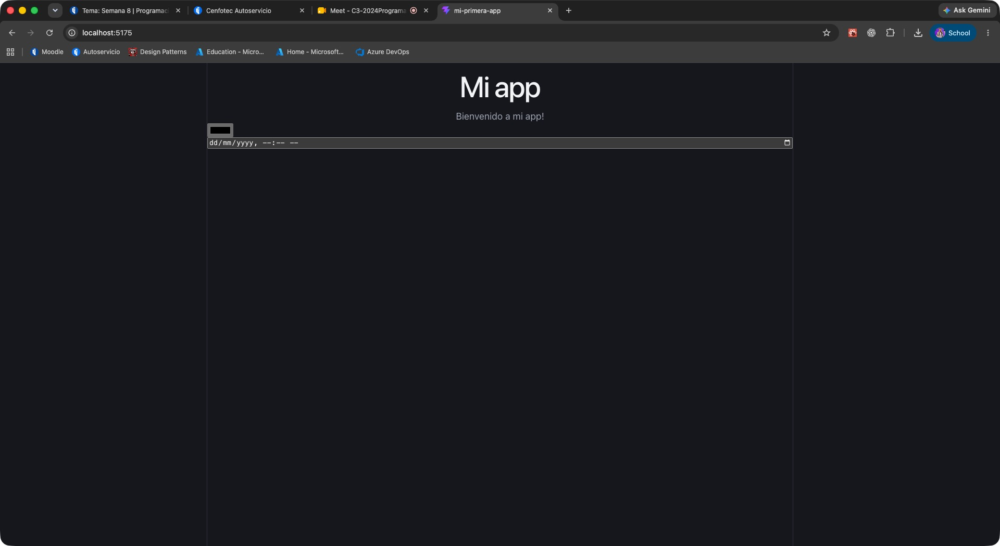

Código: `proyectos-base/mi-primera-app/src/main.jsx y App.jsx` (rutas desde la raíz de tarea-3).

### Explique el recorrido

| Paso | Pieza | Qué ocurre |
|---|---|---|
| 1 | main.jsx | createRoot toma el nodo root de index.html. |
| 2 | App | Retorna el título y el componente Saludo. |
| 3 | Saludo | Retorna el mensaje y los controles nativos. |
| 4 | React DOM | Reconcilia el JSX y muestra la pantalla. |

### Reflexiona / repaso del código

React describe la interfaz mediante componentes. JSX expresa elementos; un componente empieza con mayúscula y retorna un árbol. createRoot monta el árbol en el documento.

### Experimentos y observaciones

Se abrió el proyecto original en Chrome y se comprobó la compilación. Los controles son nativos; no se les atribuye estado React.

## 2. Componentes: de HTML/Bootstrap a React

Código: `proyectos-base/pura-vida-react/src/App.jsx y components/` (rutas desde la raíz de tarea-3).

### Explique el recorrido

| Paso | Pieza | Qué ocurre |
|---|---|---|
| 1 | App | Compone Navbar, Hero, listas, tabla, testimonios, contacto y Footer. |
| 2 | ListaTours | map convierte los datos en tarjetas con key. |
| 3 | TablaReservas | map genera filas y clasifica el estado visual. |
| 4 | main.jsx | Importa estilos y monta App. |

### Reflexiona / repaso del código

Bootstrap compilado evita configurar Sass; Sass conviene para personalizar variables y reducir estilos durante el build. React genera el DOM a partir del JSX, por lo que no hay que buscar cada contenedor con getElementById. forEach recorre y no devuelve una lista de elementos; map sí la devuelve. key permite identificar hermanos entre renders; duplicarla vuelve ambiguo ese emparejamiento. Las tarjetas actuales dependen de los datos dentro del componente: extraer una tarjeta con props permite reutilizar su estructura.

### Experimentos y observaciones

Se abrió Pura Vida en Chrome y compiló. Contacto y testimonios están en el código original. No se afirma haber ejecutado ahora todos los cambios de práctica ni las capturas móviles del enunciado histórico.

## 3. Props y children

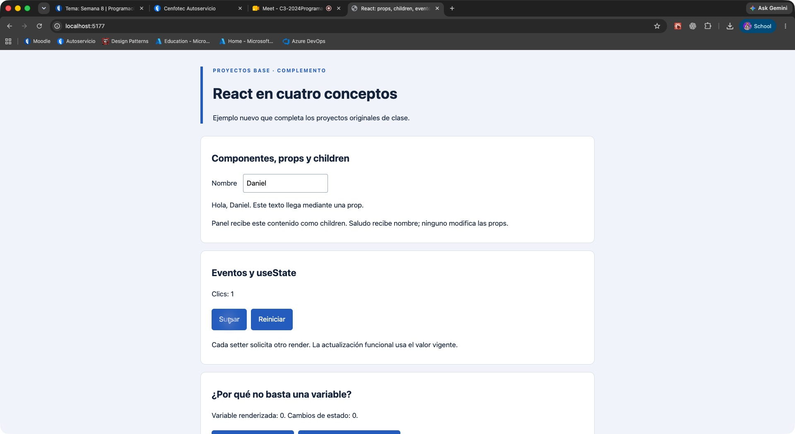

Código: `proyectos-base/conceptos-interactivos/src/App.jsx` (rutas desde la raíz de tarea-3).

### Explique el recorrido

| Paso | Pieza | Qué ocurre |
|---|---|---|
| 1 | App | Guarda nombre y lo actualiza con onChange. |
| 2 | Saludo | Recibe nombre como prop de solo lectura. |
| 3 | Panel | Recibe titulo y children, sin copiar estado. |
| 4 | React | Vuelve a evaluar el árbol al cambiar el nombre. |

### Reflexiona / repaso del código

Las props comunican del padre al hijo. children contiene los nodos colocados entre las etiquetas del componente. Si el hijo debe pedir un cambio, recibe una función; no modifica las props.

### Experimentos y observaciones

Complemento nuevo abierto en Chrome; se verificó su montaje y el contenido compuesto.

## 4. Eventos y useState

Código: `proyectos-base/conceptos-interactivos/src/App.jsx` (rutas desde la raíz de tarea-3).

### Explique el recorrido

| Paso | Pieza | Qué ocurre |
|---|---|---|
| 1 | Botón Sumar | onClick entrega una función; no la ejecuta durante render. |
| 2 | Contador | setCantidad(actual => actual + 1) calcula desde el estado vigente. |
| 3 | React | Agenda otro render con el nuevo número. |
| 4 | JSX | Muestra Clics: 1 y conserva la prop children del panel. |

### Reflexiona / repaso del código

useState devuelve el valor y un setter. Una variable local no pide un render. Se pasa onClick={funcion}, no el resultado de llamar funcion(). La actualización funcional evita depender de una captura antigua.

### Experimentos y observaciones

Se pulsó Sumar: la interfaz pasó de Clics: 0 a Clics: 1; quedó capturado.

## 5. Maratón: montaje del proyecto

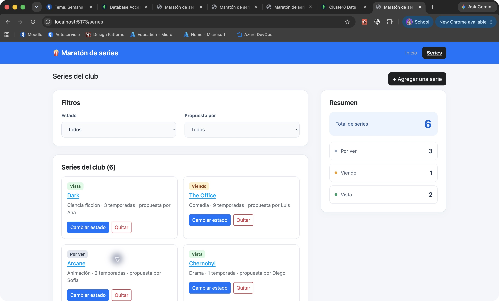

Código: `maraton-series/cliente/src/main.jsx` (rutas desde la raíz de tarea-3).

### Explique el recorrido

| Paso | Pieza | Qué ocurre |
|---|---|---|
| 1 | Vite | Sirve index.html y el módulo main.jsx. |
| 2 | main.jsx | Monta React y BrowserRouter con los estilos. |
| 3 | App | Declara las rutas. |
| 4 | Layout | Muestra navegación y Outlet con la página activa. |

### Reflexiona / repaso del código

Un componente separa una responsabilidad de interfaz; el import debe coincidir en mayúsculas y ruta. StrictMode puede montar/limpiar efectos adicionalmente en desarrollo; no significa que producción duplique cada escritura.

### Experimentos y observaciones

Captura acumulativa del cliente conectado a Atlas; build final aprobado. No hay un snapshot separado de la primera etapa.

## 6. Maratón: armar el tablero con componentes

Código: `maraton-series/cliente/src/paginas y componentes` (rutas desde la raíz de tarea-3).

### Explique el recorrido

| Paso | Pieza | Qué ocurre |
|---|---|---|
| 1 | PaginaSeries | Coordina datos, carga y errores. |
| 2 | Filtros | Recibe valores y callbacks por props. |
| 3 | ListaSeries | Mapea las series visibles. |
| 4 | TarjetaSerie y Resumen | Representan cada serie y las cantidades calculadas. |

### Reflexiona / repaso del código

Separar componentes reduce duplicación y delimita responsabilidades. key debe usar _id estable de Mongo, no la posición del arreglo. El padre administra la colección y el hijo solicita acciones mediante callbacks.

### Experimentos y observaciones

Se revisó el tablero real con seis series; es la versión acumulativa con Router.

## 7. Maratón: useState y actualizaciones inmutables

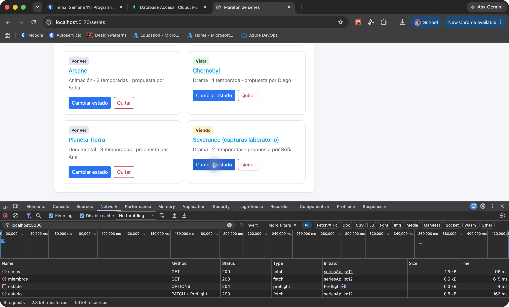

Código: `maraton-series/cliente/src/paginas/PaginaSeries.jsx y componentes/series/` (rutas desde la raíz de tarea-3).

### Explique el recorrido

| Paso | Pieza | Qué ocurre |
|---|---|---|
| 1 | Tarjeta | Solicita un cambio de estado. |
| 2 | API | Confirma la modificación persistente. |
| 3 | Setter funcional | map reemplaza solo la serie confirmada con nueva referencia. |
| 4 | Render | Tarjetas y resumen se recalculan. |

### Reflexiona / repaso del código

useState devuelve estado y setter. Mutar y pasar la misma referencia puede omitir render. filter crea el arreglo sin la serie quitada; splice mutaría. El spread conserva propiedades al sustituir estado. La cantidad se deriva de length, sin otro useState.

### Experimentos y observaciones

PATCH 200 y cambio a Viendo comprobados contra Atlas. El resultado se captura en la misma tarjeta; las pruebas de omisiones de código no se atribuyen a esta corrida.

## 8. Maratón: ¿por qué no basta una variable?

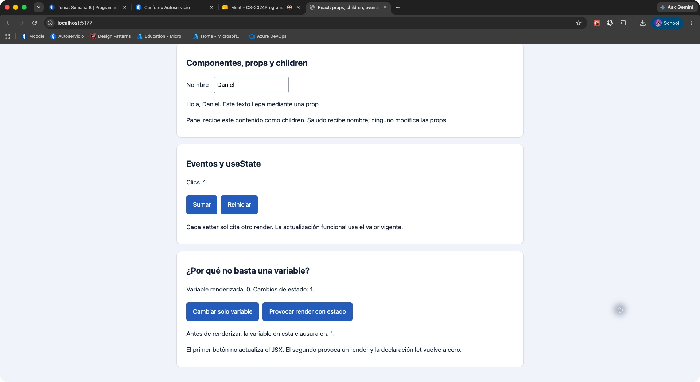

Código: `proyectos-base/conceptos-interactivos/src/App.jsx (demostración aislada)` (rutas desde la raíz de tarea-3).

### Explique el recorrido

| Paso | Pieza | Qué ocurre |
|---|---|---|
| 1 | Cambiar solo variable | Incrementa let dentro de la clausura del evento. |
| 2 | Pantalla | No recibe una solicitud de render y sigue en cero. |
| 3 | Provocar render | Actualiza estado y conserva el valor observado como mensaje. |
| 4 | Nueva invocación | let vuelve a cero; el contador de estado permanece en uno. |

### Reflexiona / repaso del código

Una asignación ordinaria no notifica a React. Una variable dentro del componente se vuelve a declarar al invocarlo. El estado persiste entre renders; la clausura del evento puede conservar un valor anterior sin convertirlo en estado.

### Experimentos y observaciones

Experimento ejecutado: variable visual cero, contador de renders uno y mensaje que registra el valor uno antes del render. Es un ejemplo nuevo del mismo concepto, separado del Maratón final.

## 9. Maratón: filtros y resumen

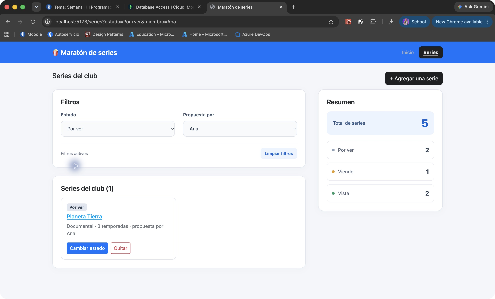

Código: `maraton-series/cliente/src/componentes/filtros y paginas/PaginaSeries.jsx` (rutas desde la raíz de tarea-3).

### Explique el recorrido

| Paso | Pieza | Qué ocurre |
|---|---|---|
| 1 | Select | Solicita cambiar estado o miembro. |
| 2 | Router | Actualiza searchParams. |
| 3 | Página | Filtra el arreglo y deriva los conteos, sin duplicar colecciones. |
| 4 | JSX | Lista Planeta Tierra para Por ver y Ana; la URL conserva ambos filtros. |

### Reflexiona / repaso del código

El estado compartido se coloca en el ancestro común o en la URL si debe ser enlazable. La lista visible y los totales son datos derivados, no copias de estado. Recargar la dirección conserva los filtros.

### Experimentos y observaciones

Filtro doble ejecutado contra Atlas; URL y resultado visibles en captura.

## 10. Maratón: formulario controlado

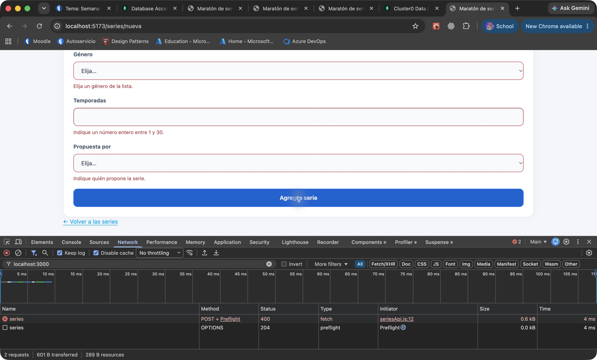

Código: `maraton-series/cliente/src/componentes/formulario/FormularioSerie.jsx` (rutas desde la raíz de tarea-3).

### Explique el recorrido

| Paso | Pieza | Qué ocurre |
|---|---|---|
| 1 | Input | value viene de datos; onChange lee name/value. |
| 2 | cambiar | Spread conserva los otros campos. |
| 3 | submit | preventDefault evita navegación nativa y validarSerie genera mensajes. |
| 4 | onAgregar | Entrega datos al padre; la versión final espera POST antes de limpiar. |

### Reflexiona / repaso del código

Es controlado porque React decide value. [name] elige la propiedad y ...datos conserva las otras. Sin preventDefault el envío nativo navega. aria-describedby conecta errores con campos. El servidor genera _id y estado Por ver; la versión anterior local usaba Date.now, que no garantiza unicidad. En la versión final los miembros vienen del API.

### Experimentos y observaciones

Los registros anteriores del formulario documentan las pruebas sin spread y sin preventDefault, restauradas después. En la prueba nueva se omitió solo el retorno de validación local para observar 400 del API; se restauró y recompiló.

## 11. El API escuchando peticiones

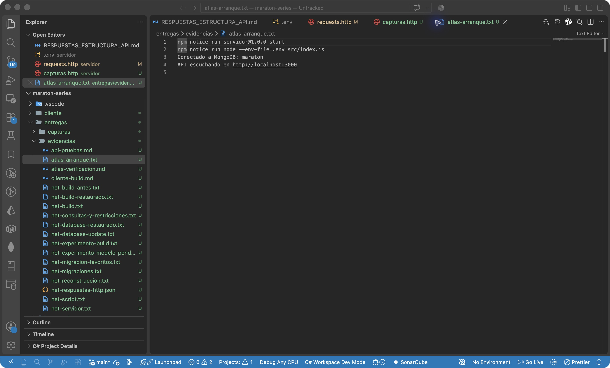

### Actividad 8 — Recorrido del POST con JSON mal escrito

| # | Pieza | Qué hace con la petición 3 |
|---|---|---|
| 1 | `app.listen` en `index.js` | Pone el servidor a escuchar en el puerto configurado. Al llegar la petición HTTP, el servidor la entrega a la aplicación Express; `app.listen` no es un middleware que se ejecute en cada petición. |
| 2 | `cors` | Agrega el encabezado `Access-Control-Allow-Origin` con el origen configurado y deja continuar la petición. También estará presente en la respuesta de error. |
| 3 | `express.json()` | Detecta `Content-Type: application/json` e intenta convertir el cuerpo en un objeto. Como el JSON está incompleto, avisa un error de tipo `entity.parse.failed`. |
| 4 | `rutaNoEncontrada` | No se ejecuta para esta petición. Al recibir un error, Express salta los middlewares normales y busca un manejador de errores posterior. |
| 5 | `manejarErrores` | Reconoce `entity.parse.failed` y responde una sola vez: estado 400 y `{"error":{"codigo":"JSON_INVALIDO","mensaje":"El cuerpo no es un JSON válido."}}`. |

### Reflexiona

1. **¿Qué diferencia hay entre una petición y una respuesta? ¿Cuáles son las partes de cada una?** La petición es el mensaje con el que el cliente solicita una operación: método HTTP, dirección, encabezados y cuerpo opcional. La respuesta es la contestación del servidor: código de estado, encabezados y cuerpo, cuando corresponde.

2. **¿Por qué rutaNoEncontrada usa next(new HttpError(…)) en lugar de responder directamente?** Para pasar el problema al manejador común. Así todas las respuestas de error usan el mismo formato y no se repite la lógica de construirlas en cada middleware.

3. **¿Cómo sabe Express que manejarErrores es un manejador de errores?** Por su firma de cuatro parámetros en el orden `(err, req, res, next)`. Se conserva `next` aunque no se utilice dentro de la función.

4. **¿Por qué cors va primero y manejarErrores de último en app.js?** CORS agrega sus encabezados antes de que otra pieza pueda fallar, para que el navegador pueda leer incluso las respuestas de error desde el origen configurado. El manejador de errores va después de las piezas que pueden avisar errores, incluida `rutaNoEncontrada`, porque Express busca los manejadores hacia adelante.

5. **¿Para quién es codigo y para quién es mensaje? ¿Para qué servirá detalles?** `codigo` es un identificador estable que el programa puede comparar; `mensaje` es una explicación para la persona. `detalles` permitirá devolver errores por campo del formulario. Cuando vale `undefined`, la serialización JSON omite esa propiedad.

6. **¿Por qué, en un error 500, el API no le envía al cliente el detalle técnico?** Porque puede revelar rutas internas, consultas, configuración u otros datos sensibles y no ayuda a la persona a resolver el problema. El servidor registra el error técnico en su terminal y entrega al cliente un código y un mensaje genéricos.

### Verificación realizada

- `GET /api/series`: 404, `RUTA_NO_ENCONTRADA`, mensaje `No existe GET /api/series`.
- `GET /api`: 404, `RUTA_NO_ENCONTRADA`, mensaje `No existe GET /api`.
- `POST /api/series` con el cuerpo incompleto de `requests.http`: 400, `JSON_INVALIDO`.
- Las tres respuestas tienen contenido JSON y `Access-Control-Allow-Origin: http://localhost:5173`; ninguna incluye `detalles` ni imprime errores en la terminal.
- Se comprobó el fallo de arranque sin `CLIENT_ORIGIN` mediante un proceso aislado con esa variable ausente, equivalente al experimento de comentar la línea. El `.env` original no se modificó.
- Las peticiones se ejecutaron automáticamente por HTTP contra el API real; también están disponibles para envío manual desde REST Client.

### Precisiones

CORS no es autenticación: el navegador aplica la restricción de lectura por origen; REST Client y otros programas pueden enviar peticiones. Esta etapa no conecta MongoDB, aunque comprueba que `MONGODB_URI` esté definida. En esa etapa histórica se usaba una URI de ejemplo; la configuración actual ya apunta a Atlas.

### Evolución del proyecto

Las verificaciones anteriores corresponden a la etapa 2. En la versión final GET /api/series responde 200 y la prueba de ruta inexistente usa /api/peliculas. La versión actual ya conecta con Atlas; las capturas acumulativas están en `capturas/README.md`.

## 12. Conexión a MongoDB

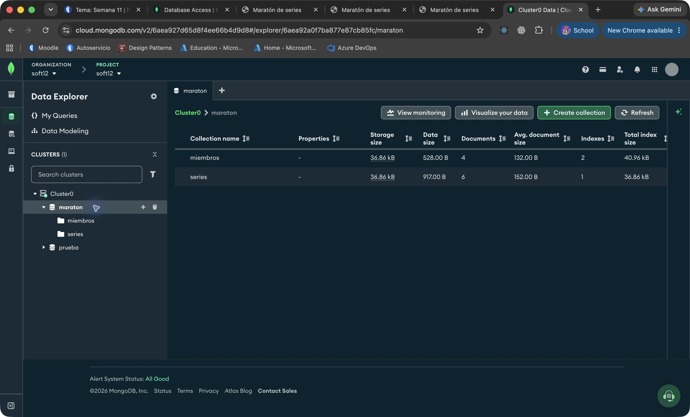

### Recorrido

| # | Pieza | Qué ocurre |
|---|---|---|
| 1 | package.json · dev | Node carga .env, activa --watch y ejecuta src/index.js. |
| 2 | config/env.js | Exige las variables y exporta la configuración. |
| 3 | config/db.js · new MongoClient | Crea el cliente compartido; todavía no abre la conexión. |
| 4 | index.js · await conectar() | Espera la conexión; si falla, no continúa hacia listen. |
| 5 | config/db.js · cliente.db | Selecciona la base configurada y conserva su referencia. |
| 6 | index.js · app.listen | Abre el puerto HTTP después de conectar. |

La conexión y el arranque se comprobaron primero con MongoDB local y después con Atlas. Los errores reales de autenticación y DNS están registrados al final de esta respuesta.

### Reflexiona

1. **¿Por qué el API se conecta a MongoDB una sola vez y no en cada petición?**

   La conexión inicial cuesta tiempo y recursos. Un MongoClient compartido administra su pool y lo reutiliza entre peticiones.

2. **¿Qué hace await conectar() y qué pasaría si se escribiera sin await?**

   Espera que termine la promesa de conexión. Sin await, listen podría aceptar peticiones antes de que exista una base disponible; además, el rechazo quedaría sin manejar en ese punto.

3. **En el experimento 6.1, ¿por qué no apareció «API escuchando»?**

   La autenticación rechazada hace fallar await conectar(); no se alcanza app.listen.

4. **¿Qué comprueba el mensaje «Conectado a MongoDB» y qué no comprueba?**

   En este código, connect comprueba la conectividad inicial. No prueba que el nombre de la base sea correcto, que las colecciones existan ni todos los permisos de lectura y escritura. En una instancia sin autenticación, tampoco valida credenciales.

5. **¿Qué controla Database Access y qué controla Network Access?**

   Database Access controla usuarios y permisos; Network Access controla las direcciones IP permitidas para llegar al clúster.

6. **¿Para qué servirá obtenerDb() en la siguiente etapa?**

   Entrega la misma referencia a la base conectada a los repositorios y falla claramente si se usa antes de conectar.

### Experimentos y evidencias

Atlas: conexión y ping correctos; contraseña inválida rechazó con código 8000 y dominio inexistente con ETIMEOUT. La URI original se mantuvo intacta. Véase `evidencias/atlas-verificacion.md`.

Capturas: [índice](capturas/README.md).

## 13. Módulo miembros

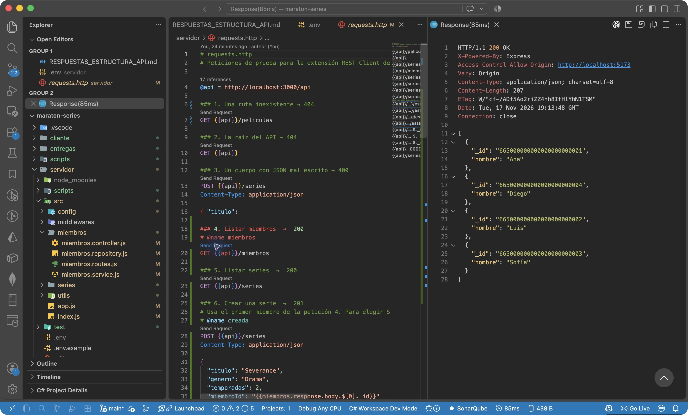

### Recorrido

| # | Pieza | Qué ocurre |
|---|---|---|
| 1 | app.js | Monta el router bajo /api/miembros. |
| 2 | miembros.routes.js | Relaciona GET / con controlador.listar. |
| 3 | miembros.controller.js | Espera servicio.listar; no conoce consultas MongoDB. |
| 4 | miembros.service.js | Define la entrada a las reglas de miembros y llama al repositorio. |
| 5 | miembros.repository.js | Ejecuta find, projection, sort y toArray. |
| 6 | MongoDB | Filtra y devuelve los documentos solicitados. |
| 7 | Controlador de vuelta | Serializa el arreglo con res.json y responde 200. |

GET /api/miembros se verificó por HTTP con MongoDB real. Los fallos de omitir toArray y await se explican como resultados esperados, sin afirmar que se modificó el código para provocarlos.

### Reflexiona

1. **¿Qué pregunta responde cada una de las cuatro capas?**

   El router decide qué URL y método atender; el controlador traduce HTTP; el servicio aplica reglas; el repositorio define cómo consultar o guardar.

2. **¿Por qué existe el servicio si para listar no hay reglas?**

   Preserva una entrada estable para las reglas futuras. Series consulta existe en este servicio y no se acopla al repositorio de miembros.

3. **¿Por qué en el router la ruta es '/' y no '/api/miembros'?**

   El prefijo ya está en app.use. Repetirlo produciría /api/miembros/api/miembros.

4. **¿Qué es un cursor y qué pasó en el experimento 7.1?**

   Un cursor representa resultados que todavía se recorren. Sin toArray se devuelve el cursor, no una lista JSON; su serialización puede fallar por referencias circulares.

5. **¿Por qué el experimento 7.2 respondió 200 si estaba mal?**

   Sin await, res.json recibe una promesa. Normalmente se serializa como {} con 200 porque todavía no se esperó el resultado; el estado HTTP por sí solo no demuestra que el contenido sea correcto.

6. **¿Por qué POST /api/miembros responde 404 si la dirección es la misma que la del GET?**

   Una ruta es la combinación de método y dirección. Solo está registrado GET; POST termina en rutaNoEncontrada.

### Experimentos y evidencias

GET miembros 200 con los cuatro miembros de Atlas, capturado en REST Client.

Capturas: [índice](capturas/README.md).

## 14. Listar y crear series

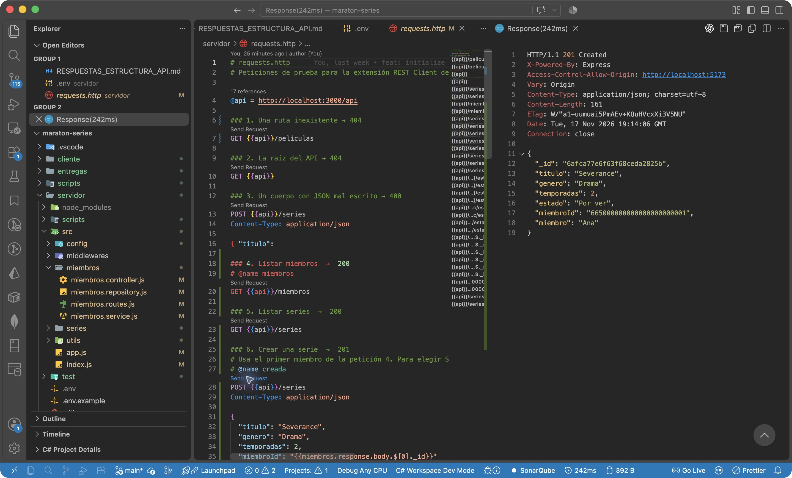

### Recorrido

| # | Pieza | Qué ocurre |
|---|---|---|
| 1 | express.json | Convierte el cuerpo JSON en req.body. |
| 2 | series.routes.js | Selecciona POST /. |
| 3 | series.controller · crear | Pasa req.body o {} al servicio. |
| 4 | series.validacion.js | Acumula errores de título, género, temporadas y miembroId. |
| 5 | miembros.service · existe | Comprueba que la referencia apunte a un miembro existente. |
| 6 | series.service · repositorio.crear | Construye campos permitidos, ObjectId, estado Por ver y calificaciones vacías; inserta. |
| 7 | series.repository · buscarPorId | Lee la serie creada y une el nombre del miembro. |
| 8 | Controlador · status(201) | Responde Created con la serie completa. |

La petición 8 se detiene en la fila 5: el servicio lanza HttpError con detalles.miembroId y manejarErrores escribe el 400. Creación, tipos, campos extra y referencia inexistente están cubiertos por las pruebas HTTP.

### Reflexiona

1. **¿Por qué series pregunta a miembros.service y no a miembros.repository?**

   El servicio es el contrato público del módulo miembros. Así sus reglas pueden cambiar sin repartir dependencias sobre su persistencia.

2. **¿Por qué se valida en el servidor si el formulario de React también valida?**

   El navegador se puede omitir. El servidor protege los datos enviados por cualquier cliente y ofrece errores por campo.

3. **¿Qué pasaría si el servicio guardara req.body tal cual con insertOne(datos)? Use el resultado del paso 7 de la Tarea 7.**

   Permitiría guardar campos arbitrarios, un estado inicial impuesto por el cliente o tipos incorrectos. El servicio construye explícitamente el documento y fuerza Por ver.

4. **¿Por qué se convierte miembroId con new ObjectId(…) antes de guardar?**

   La referencia en MongoDB es ObjectId. Un texto con los mismos caracteres no tiene el mismo tipo y no coincidiría en el lookup.

5. **¿Qué hace cada etapa de CON_MIEMBRO? ¿Qué demostró el experimento de la Actividad 8?**

   lookup busca el miembro; unwind extrae el documento del arreglo; set conserva su nombre; project excluye calificaciones. Una colección mal escrita produce un arreglo vacío y unwind descarta las series, aunque existan.

6. **¿Por qué crear responde 201 y con la serie leída de la base, y no con los datos que llegaron?**

   201 informa que se creó un recurso. Leerlo de nuevo devuelve el ID, el estado real y el nombre del miembro, que no estaban completos en el cuerpo recibido.

### Experimentos y evidencias

POST Severance 201 y POST inválido 400 capturados en REST Client contra Atlas; Severance siguió visible después de recargar React.

Capturas: [índice](capturas/README.md).

## 15. Cambiar estado y eliminar

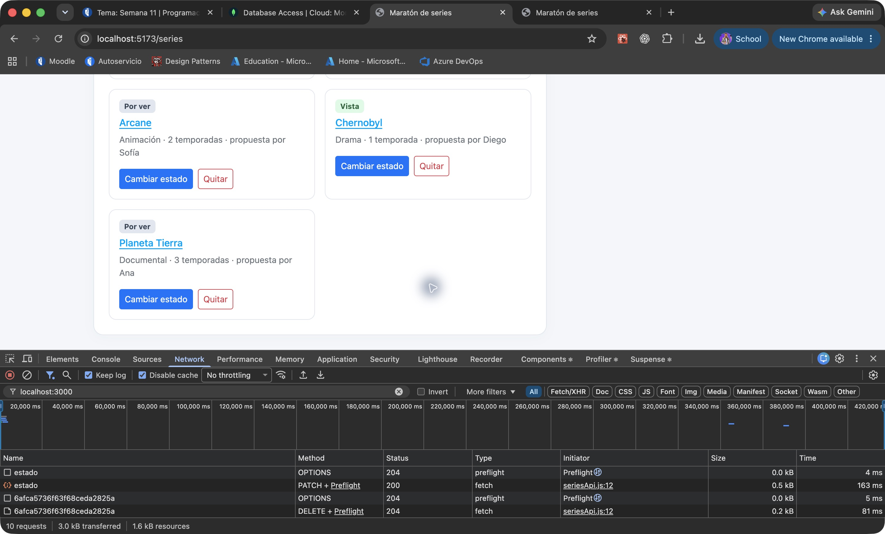

### Recorrido

| # | Pieza | Qué ocurre |
|---|---|---|
| 1 | app.js | Dirige /api/series al router. |
| 2 | series.routes · PATCH /:id/estado | Extrae el parámetro de ruta y llama al controlador. |
| 3 | series.controller · cambiarEstado | Entrega id y cuerpo al servicio. |
| 4 | revisarId | Rechaza IDs mal formados con 400. |
| 5 | validarEstado | Acepta únicamente Por ver, Viendo o Vista. |
| 6 | repositorio.cambiarEstado | Usa updateOne y matchedCount para detectar existencia. |
| 7 | repositorio.buscarPorId | Lee la versión guardada con el nombre del miembro. |
| 8 | Controlador · res.json | Responde 200 con la serie actualizada. |

Petición 11: fila 4, 400. Petición 10: fila 5, 400. Petición 12: fila 6, seguida de la decisión del servicio, 404. Las pruebas verifican estos casos, PATCH repetido y DELETE 204 seguido de 404.

### Reflexiona

1. **¿Por qué el id va en la dirección y el estado nuevo en el cuerpo?**

   El ID identifica el recurso y el cuerpo expresa el cambio parcial que se pide aplicar.

2. **¿Qué diferencia hay entre responder 400 ID_INVALIDO y 404 NO_ENCONTRADA? ¿Quién detecta cada uno?**

   400 ID_INVALIDO es un formato imposible, detectado por revisarId. 404 NO_ENCONTRADA es un ID válido sin documento, detectado por el servicio al interpretar el resultado del repositorio.

3. **¿Por qué revisarId está en utils y no en la carpeta series?**

   Es una comprobación reutilizable de identificadores, independiente del módulo y de HTTP.

4. **¿Qué demostró el experimento 8.2 sobre matchedCount y modifiedCount?**

   matchedCount informa si hubo coincidencia. modifiedCount puede valer cero al repetir el mismo estado aunque la serie exista; usarlo como existencia produciría un 404 incorrecto.

5. **En el experimento 8.3, la serie se borró aunque REST Client no recibió respuesta. ¿Qué problema causaría esto en React?**

   React quedaría esperando o terminaría mostrando un error aunque la base ya cambió. Solo status no envía la respuesta: hace falta end.

6. **¿Por qué el segundo DELETE a la misma serie responde 404? ¿En qué situación real pasaría?**

   La primera petición eliminó el recurso; la segunda ya no lo encuentra. Puede ocurrir por reintentos o porque otra pestaña ya lo borró.

### Experimentos y evidencias

PATCH 200 y DELETE 204 capturados en Red; inexistencia 404 e ID inválido 400 en REST Client. Solo se borró la serie temporal autorizada.

Capturas: [índice](capturas/README.md).

## 16. React lee el API

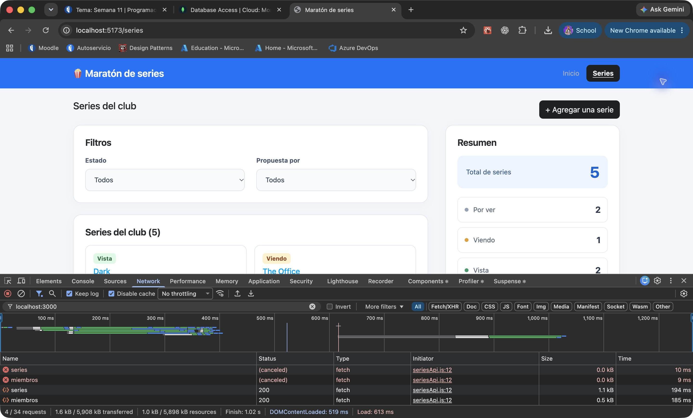

### Recorrido

| # | Pieza | Qué ocurre |
|---|---|---|
| 1 | Primer dibujo | La lista está vacía y cargando es true. |
| 2 | useEffect · cargar | Inicia series y miembros en paralelo con Promise.all. |
| 3 | seriesApi · obtenerSeries → pedir | Envía GET con fetch a la URL configurada. |
| 4 | API · GET /api/series | Recorre las capas y consulta MongoDB con lookup. |
| 5 | seriesApi · respuesta.json | Lee el cuerpo y comprueba el estado HTTP. |
| 6 | setSeries y setMiembros | Guarda las dos listas recibidas. |
| 7 | finally | Finaliza cargando salvo que el efecto se haya cancelado. |
| 8 | Siguiente dibujo | Renderiza tarjetas, filtros y resumen con los datos del API. |

En la versión final con Router, este estado y efecto viven en PaginaSeries. En 9.1 falla fetch en la fila 3 y se muestra la alerta. En la guía, 9.3 causa una URL undefined y falla JSON en la fila 5; aquí la ausencia de VITE_API_URL se detecta antes con un mensaje explícito. Se añadieron cancelaciones para evitar respuestas viejas.

### Reflexiona

1. **¿Por qué la dirección del API va en un .env y no escrita en seriesApi.js?**

   Permite cambiar la dirección entre entornos sin editar las funciones. En Vite se incorpora al cliente al arrancar o compilar; cambiarla requiere reiniciar o recompilar según el caso.

2. **¿Por qué no se pueden poner secretos en una variable VITE_?**

   Vite incorpora VITE_ al código del navegador. Cualquier visitante puede leerlo; no es un almacén de secretos.

3. **¿Qué diferencia hay entre el error del experimento 9.1 y el del 9.2, si la página muestra el mismo mensaje? ¿Dónde se nota?**

   Con el servidor apagado no llega respuesta. Con CORS el API puede responder, pero el navegador impide leerla. La consola y la pestaña Red distinguen conexión rechazada de origen no autorizado.

4. **¿Por qué la petición va dentro de useEffect? ¿Qué demostró el experimento 9.4?**

   El efecto sincroniza el componente con el API después de dibujar. Sin dependencias, cada actualización provoca otra consulta y sus respuestas causan más dibujos.

5. **¿Por qué setCargando(false) va en finally?**

   finally se ejecuta tanto si hay datos como si hay error; de otro modo podría quedar el mensaje Cargando para siempre.

6. **Al agregar una serie y recargar, la serie desaparece. ¿Qué tendría que hacer agregar para que no pase?**

   Debe enviar POST y esperar que la base confirme. El laboratorio 8 implementa esa persistencia.

### Experimentos y evidencias

Lista real de Atlas, GET 200 y error CORS reproducido desde el origen 5174 con diagnóstico en consola. Se cerró el servidor experimental 5174.

Capturas: [índice](capturas/README.md).

## 17. Formulario con POST

### Recorrido

| # | Pieza | Qué ocurre |
|---|---|---|
| 1 | Formulario · validarSerie | Revisa campos antes de enviar. |
| 2 | setEnviando(true) | Bloquea envíos repetidos y muestra Guardando. |
| 3 | agregar | Espera crearSerie; deja que los errores lleguen al formulario. |
| 4 | seriesApi · crearSerie → pedir | Envía POST con Content-Type JSON y JSON.stringify. |
| 5 | API · POST /api/series | Valida, comprueba miembro, inserta y devuelve 201. |
| 6 | Pantalla tras guardar | En etapa 8 agrega la respuesta a la lista; con Router navega a /series y vuelve a consultarla. |
| 7 | setDatos(VACIO) | Solo limpia tras una creación confirmada. |
| 8 | finally | Desactiva enviando también cuando hubo error. |

Con 400 el recorrido se desvía en la fila 5: pedir lanza un Error con detalles, el formulario muestra mensajes por campo, conserva datos y finalmente habilita el envío. Con Router no se navega si falla. Se comprobó visualmente el error del API al omitir temporalmente el retorno de la validación local; después se restauró el código.

### Reflexiona

1. **¿Qué tres piezas necesita fetch para enviar datos? ¿Qué demostraron los experimentos 7.2 y 7.3?**

   Método POST, encabezado Content-Type: application/json y cuerpo JSON.stringify(datos). Sin el encabezado express.json no interpreta el texto; sin stringify llega [object Object], que es JSON inválido.

2. **¿Por qué agregar llama primero al API y después a setSeries?**

   La pantalla debe representar lo que se guardó. Si cambia antes y la petición falla, mostraría una creación inexistente.

3. **¿Por qué agregar no tiene try/catch?**

   El error debe propagarse al formulario, que conoce los campos y puede mostrar detalles sin perder lo escrito. La página NuevaSerie conserva ese patrón.

4. **¿Por qué el formulario envía el miembroId y no el nombre?**

   El ID identifica al miembro y establece la referencia. El nombre es una etiqueta de presentación y podría repetirse o cambiar.

5. **Si el navegador ya valida, ¿por qué el API valida otra vez?**

   La validación del navegador mejora la experiencia, pero puede omitirse. La del API protege la base frente a todos los clientes.

6. **¿Qué problema mostró el experimento 7.4?**

   Sin await el formulario se limpia antes de recibir la confirmación; un rechazo posterior no entra en ese catch, deja datos perdidos y una promesa rechazada sin manejar.

### Experimentos y evidencias

Se creó la serie temporal desde el formulario. Se omitió temporalmente el retorno de la validación local para enviar campos vacíos: POST 400, cuerpo enviado y errores del API visibles. La validación local se restauró. El POST válido 201 adicional de Severance se capturó en REST Client y su persistencia después de recargar en React.

Capturas: [índice](capturas/README.md).

## 18. Cambiar estado y quitar desde React

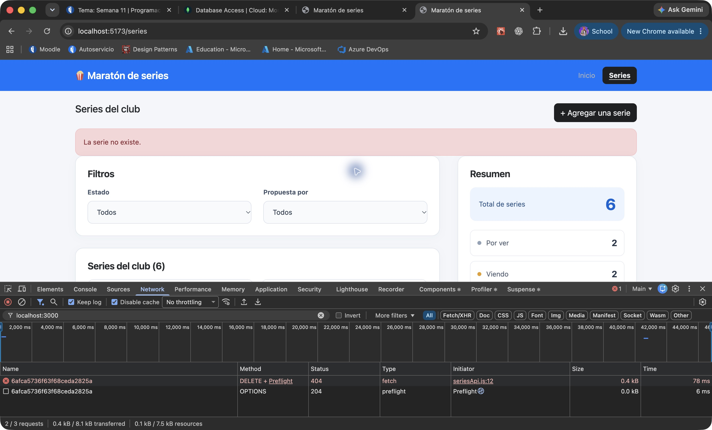

### Recorrido

| # | Pieza | Qué ocurre |
|---|---|---|
| 1 | TarjetaSerie · Quitar | Entrega serie._id a onQuitar. |
| 2 | PaginaSeries · quitar | Espera la eliminación del API. |
| 3 | seriesApi · eliminarSerie → pedir | Envía DELETE /series/:id sin cuerpo. |
| 4 | Rutas y controlador del API | Seleccionan eliminar y pasan el ID al servicio. |
| 5 | Servicio · eliminar | Revisa formato e interpreta inexistencia como 404. |
| 6 | Repositorio · deleteOne | Borra y devuelve si deletedCount es 1. |
| 7 | seriesApi · 204 | Devuelve null sin intentar leer JSON. |
| 8 | setSeries | Filtra sobre la lista vigente mediante una función. |

En 4.1 la fila 5 detecta que ya no existe y devuelve 404; la tarjeta local se conserva y se muestra el error. En 4.3 el problema está en fila 7 al intentar leer JSON vacío. La versión final bloquea acciones simultáneas sobre una misma tarjeta; permite operar en tarjetas distintas y actualiza funcionalmente.

### Reflexiona

1. **¿Por qué pedir() revisa el 204 antes de llamar a respuesta.json()? ¿Qué mostró el experimento 4.3?**

   204 no contiene JSON. Intentar leerlo lanza un error de fin de entrada aunque DELETE haya funcionado.

2. **¿Por qué avanzar pone en la tarjeta la serie que devolvió el API y no la que calculó React?**

   La respuesta es la versión confirmada por el servidor; evita suponer que el estado calculado localmente coincide con el guardado.

3. **¿Qué demostró el experimento 4.4 sobre setSeries((actuales) => …)?**

   Las funciones capturan listas de un dibujo anterior. La actualización funcional recibe el estado vigente y conserva cambios que llegaron durante el await.

4. **¿Por qué agregar no tiene try/catch, pero avanzar y quitar sí?**

   Los errores de agregar pertenecen al formulario. Cambiar y quitar los muestran en la alerta de la página, por eso los capturan allí.

5. **En el experimento 4.2, ¿qué ventaja y qué riesgo tiene cambiar la pantalla antes de que responda el API?**

   Cambiar primero puede sentirse más rápido, pero exige revertir correctamente si falla. El curso usa confirmación previa para mantener coherencia.

6. **Con el mapa de la Actividad 6, ¿qué archivos tendría que crear para un recurso nuevo de su proyecto?**

   Un recurso nuevo requiere repositorio, servicio, controlador, rutas y montaje; en React, funciones API, vistas y componentes. Las reglas y mensajes deben corresponder al nuevo recurso.

### Experimentos y evidencias

PATCH 200, DELETE 204 y segundo DELETE 404 desde una pestaña desactualizada, con alerta legible. La tarjeta de la pestaña desactualizada conserva la serie al fallar, como prevé el código.

Capturas: [índice](capturas/README.md).

### Mapa completo de la actividad 6

| Pantalla | Función API | Ruta HTTP | Repositorio |
|---|---|---|---|
| Abrir lista | obtenerSeries / obtenerMiembros | GET /api/series y GET /api/miembros | listar en ambos módulos |
| Agregar | crearSerie | POST /api/series | crear y buscarPorId |
| Cambiar estado | cambiarEstadoSerie | PATCH /api/series/:id/estado | cambiarEstado y buscarPorId |
| Quitar | eliminarSerie | DELETE /api/series/:id | eliminar |

## 19. React Router

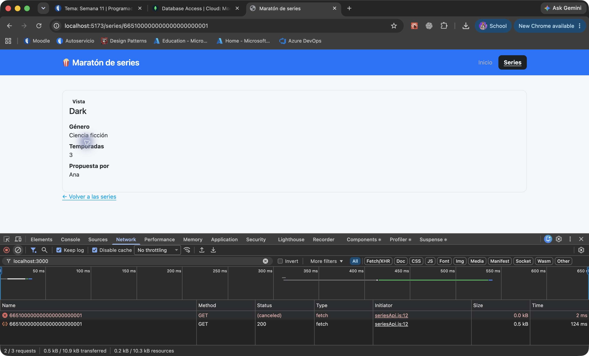

### Recorrido

| # | Pieza | Qué ocurre |
|---|---|---|
| 1 | Tarjeta · Link | Solicita navegar al detalle usando el _id. |
| 2 | BrowserRouter | Actualiza el historial sin solicitar un documento completo. |
| 3 | App · Routes | Elige series/:id según la dirección. |
| 4 | Layout · Outlet | Conserva navegación y dibuja la página hija. |
| 5 | DetalleSerie · useParams | Lee el id de la URL. |
| 6 | DetalleSerie · useEffect | Inicia la carga y crea AbortController; depende de id. |
| 7 | seriesApi · obtenerSerie → pedir | Envía GET con signal y conserva el estado HTTP de errores. |
| 8 | API · GET /api/series/:id | Valida el ID, busca la serie y responde 200, 400 o 404. |
| 9 | Detalle · setSerie y setCargando | Muestra los datos o el error correspondiente. |

Para /peliculas se elige NoEncontrada sin pedir una serie al API. Para un ID válido inexistente se completa la consulta y el API responde 404; la página muestra Serie no encontrada. Se incluyó el extra opcional de lazy y Suspense; la compilación genera un módulo separado para DetalleSerie.

### Reflexiona

1. **¿Cómo logra React Router cambiar de página sin pedir otra página al servidor? ¿Qué mostró el experimento 10.1?**

   Usa la API de historial y renderiza la ruta coincidente en React. Un enlace HTML normal provoca la carga de otro documento; Link evita esa recarga en la navegación interna.

2. **¿Por qué la ruta de Layout no tiene path y qué hace <Outlet />?**

   Es una ruta de diseño sin segmento propio. Outlet marca dónde se renderiza la página hija conservando el encabezado.

3. **¿Qué diferencia hay entre el 404 de /peliculas y el de /series/6500…? ¿Quién detecta cada uno?**

   /peliculas no coincide con ninguna ruta de página: lo detecta React Router. /series/6500… coincide con detalle, pero su recurso no existe: lo detecta el API.

4. **¿Por qué el efecto del detalle depende de [id]? ¿Qué pasaría con []?**

   El parámetro puede cambiar sin desmontar el componente. Con [] permanecerían los datos del ID anterior.

5. **¿Qué hace la limpieza del efecto y qué mostraron los experimentos 10.3 y 10.4?**

   La limpieza cancela la petición anterior al cambiar ID o salir. Sin ella pueden terminar peticiones duplicadas o viejas. AbortError debe ignorarse, no transformarse en un fallo de conexión.

6. **¿Qué se gana al guardar los filtros en la dirección? ¿Cómo se usaría lo mismo para paginar?**

   Los filtros se conservan al recargar, compartir un enlace y usar Atrás. Para paginación se guardaría por ejemplo ?pagina=2 y se derivaría la consulta del parámetro.

### Experimentos y evidencias

Detalle con URL, GET cancelado por limpieza de efecto y GET 200; filtros de estado y miembro reflejados en la URL.

Capturas: [índice](capturas/README.md).

## 20. EF Core y SQL Server

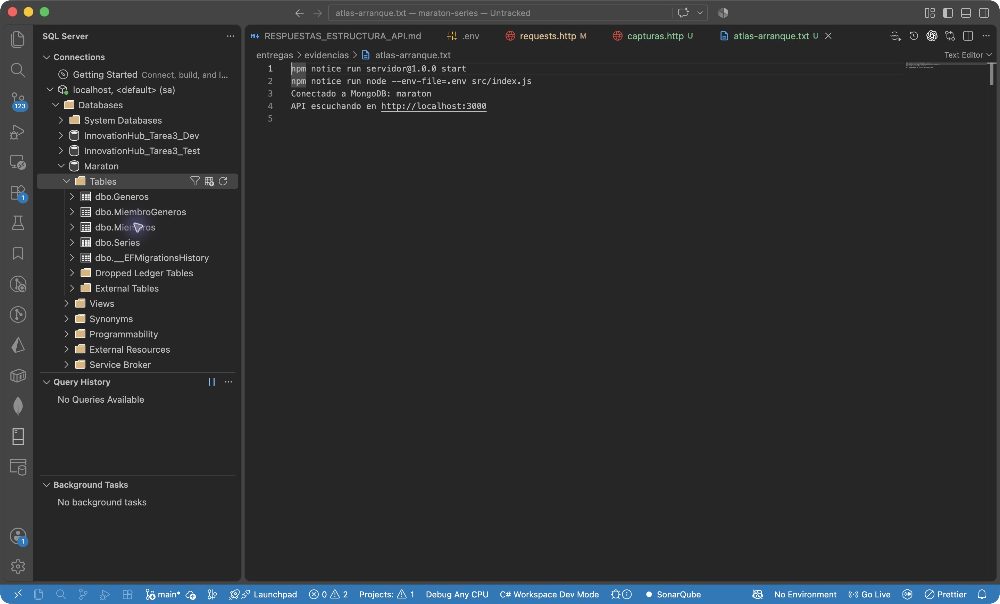

### Recorrido

| # | Pieza | Qué ocurre |
|---|---|---|
| 1 | Kestrel · 5080 | Recibe HTTP y lo entrega al pipeline ASP.NET Core. |
| 2 | MapGet /api/series | Selecciona el manejador de la ruta. |
| 3 | AddDbContext | Registra el contexto; la inyección proporciona una instancia para la petición. |
| 4 | user-secrets | La configuración de desarrollo aporta ConnectionStrings:Maraton; no se incluye en el proyecto. |
| 5 | LINQ · OrderBy y Select | Construye una consulta y proyecta los nombres del contrato. |
| 6 | ToListAsync | Ejecuta la consulta traducida sin bloquear esperando la base. |
| 7 | SQL Server · SELECT con JOIN | Une Series con Generos y Miembros. |
| 8 | Objetos anónimos → JSON | Serializa las filas proyectadas y devuelve 200. |

El orden de la tabla es explicativo: user-secrets se carga al iniciar y AddDbContext se registra antes de las peticiones. Correo único: IX_Miembros_Correo. Referencia: FK_Series_Miembros_MiembroId. Enum: CK_Series_Estado. Favoritos: MiembroGeneros con PK (MiembroId, GeneroId). No se implementó el reto opcional de calificaciones.

### Reflexiona

1. **¿Qué garantiza una clave foránea que MongoDB no garantizaba con miembroId? ¿Qué mostraron los experimentos E1 y E4?**

   La FK exige que el miembro exista y Restrict impide borrarlo si tiene series. E1 rechaza una referencia a 99 y E4 impide dejar series huérfanas.

2. **¿Por qué generosFavoritos, que en MongoDB era un arreglo dentro del miembro, necesita una tabla aparte en SQL Server?**

   Cada miembro puede tener varios géneros y cada género varios miembros. MiembroGeneros expresa ambas referencias y una PK compuesta evita repetir una pareja.

3. **¿Por qué las migraciones se suben al repositorio y la cadena de conexión no? ¿Dónde vive cada una?**

   Las migraciones y el snapshot describen cambios reproducibles y pertenecen al código. La conexión puede contener credenciales y vive en user-secrets de desarrollo o en configuración segura del despliegue.

4. **¿Qué hizo EF Core con el Select de C#? ¿Qué SQL vio en la terminal?**

   EF Core traduce la proyección LINQ a SELECT y las navegaciones a JOIN. Los alias _id, titulo y miembro producen el mismo contrato JSON sin serializar todas las entidades.

5. **¿Qué pasó en el experimento 12.5 y por qué EF Core se negó a actualizar la base?**

   El modelo difiere del snapshot si se cambia el largo sin crear una migración. EF informa PendingModelChangesWarning y rechaza database update para evitar una base que no corresponda al modelo.

6. **Si el cliente de React apuntara a este servidor, ¿qué tendría que cambiar en React? ¿Por qué?**

   Para leer las listas se cambiaría VITE_API_URL; el servidor necesita CORS para permitir al navegador leerlo. Esta guía .NET solo implementa dos GET: el cliente completo aún requiere las rutas de detalle y escritura. Sus IDs son textos de enteros y el cliente no debe exigir ObjectId.

### Experimentos y evidencias

Árbol de tablas en VS Code, consultas 3 y 6 ejecutadas desde la extensión MSSQL y GET series 200 en REST Client. La captura del error SQL muestra el registro real previamente guardado, con 547 y 2601; no es una nueva ejecución en la interfaz.

Capturas: [índice](capturas/README.md).

### Verificaciones ejecutadas

Se generaron y aplicaron Inicial y GenerosFavoritos con EF Core 10.0.14. Las seis consultas devolvieron los datos de ejemplo; los cuatro experimentos SQL fueron rechazados con los códigos esperados. El cambio temporal de HasMaxLength(100) a 120 fue rechazado por PendingModelChangesWarning y después se restauró. La reconstrucción se comprobó dos veces usando el script de migraciones en una base temporal, sin borrar Maraton. Los dos GET devolvieron 200 y la ruta no registrada devolvió 404 sin cuerpo. Los resultados están en evidencias.

## Evidencias y alcance

El [índice de capturas](capturas/README.md) identifica la procedencia de cada imagen. Los registros de pruebas están en evidencias. Las capturas de arranque y de restricciones muestran archivos de salida real abiertos en VS Code, no terminales en vivo. El Payload de Chrome corresponde al POST inválido; el POST válido 201 está capturado en REST Client. La serie temporal se creó mediante el formulario y se eliminó con autorización; Severance normal quedó como ejemplo persistido.

