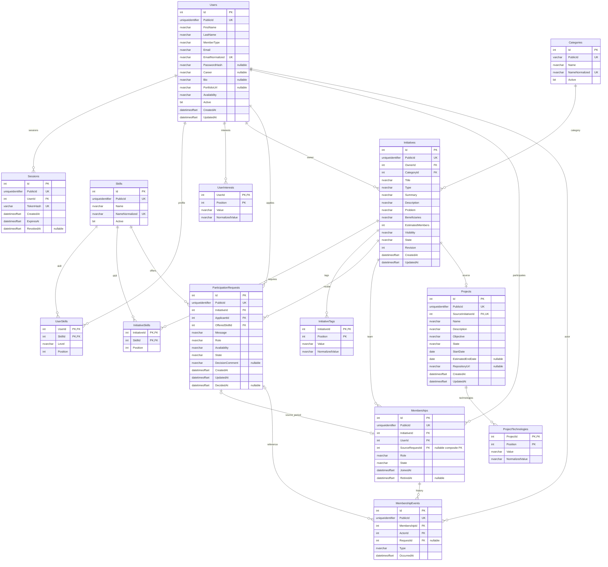

# Modelo de datos - Innovation Hub (Tarea 3)

## Diagrama

Las PK internas son INT IDENTITY y las FK INT. El contrato real del proyecto usa UUID y categorías con slug, no ObjectId públicos: se conserva ese valor en PublicId UNIQUE. Cambiarlo por un número en JSON rompería las rutas del cliente. El ejemplo ObjectId del enunciado se aplica a _id interno, no al identificador público de este proyecto.

### Relaciones requeridas

| Relación requerida | Cardinalidad y resolución |
| --- | --- |
| Usuario–competencia | M:N mediante UserSkills con nivel y posición. |
| Usuario–iniciativa (propiedad) | Usuario 1:N Initiatives, FK OwnerId; cada iniciativa tiene un dueño. |
| Usuario–iniciativa (participación) | M:N mediante Memberships, una fila por periodo; índice filtrado garantiza una activa por pareja. |
| Iniciativa–competencia | M:N mediante InitiativeSkills, posición propia. |
| Iniciativa–solicitud | 1:N mediante ParticipationRequests.InitiativeId. |
| Proyecto–iniciativa | Cada proyecto tiene exactamente una iniciativa; cada iniciativa tiene 0..1 proyecto, FK única SourceInitiativeId. |
| Proyecto–usuario (dueño) | Usuario 1:N proyectos por Projects → Initiatives.OwnerId; dueño derivado, sin columna redundante. |
| Proyecto–usuario (equipo) | M:N derivada por Projects → Initiatives → Memberships → Users; activo/histórico se distingue por periodo y estado. No se crea un segundo equipo. |

No se introduce un cupo duro: EstimatedMembers sigue en 1–100, pero no se compara contra el número de miembros. Los datos de prueba incluyen una iniciativa convertida con estimado 2 y tres activos: es válida y la disponibilidad calculada es cero.

Las FK/índices/CHECK garantizan referencias, unicidad filtrada y coherencia de cada fila. La API final requerirá transacciones para aceptar/cancelar, comprobar permisos, no solicitar siendo miembro activo o propietario, impedir retiro del dueño, validar competencia ofrecida en el momento de solicitar, convertir solo si corresponde, escribir eventos y conservar converted al aceptar después. No se afirma que los CHECK implementen por sí solos esas operaciones o transiciones.

La política de borrado se conserva: eliminar físicamente solo si nunca hubo relaciones adicionales al dueño. Las FK evitan eliminar de forma aislada iniciativas o periodos con relaciones. En el caso eliminable, el servicio deberá comprobar toda la historia y retirar explícitamente el único evento/membresía inicial del dueño en una misma transacción antes de borrar la iniciativa; las listas propias se limpian por Cascade. Las demás iniciativas se archivan mediante una acción independiente. Los servicios de escritura quedan para la entrega final.

## Tablas

Convenciones: longitudes en NVARCHAR se expresan en unidades UTF-16, comparación de valores fijos/normalizados con collation binaria; fechas UTC. Las filas con dos nombres de columnas definen ambas con el mismo tipo y obligatoriedad. Los índices filtrados y las restricciones entre columnas se describen bajo cada tabla. Restrict corresponde a NO ACTION. Las FK numéricas y PublicId se distinguen para conservar el contrato.

### Users

| Columna | Tipo | ¿Obligatoria? | Llave | Regla |
| --- | --- | --- | --- | --- |
| Id | INT IDENTITY(1,1) | Sí | PK | Identidad interna; PublicId conserva el identificador del contrato. |
| PublicId | UNIQUEIDENTIFIER | Sí | UNIQUE | Identificador público original; UUID contractual; nunca sustituir por el Id numérico en JSON. |
| FirstName | nvarchar(60) | Sí |  | CHECK longitud recortada 2–60. |
| LastName | nvarchar(80) | Sí |  | CHECK longitud recortada 2–80. |
| MemberType | nvarchar(20) | Sí |  | CHECK student/professor/administrative/graduate/external. |
| Email | nvarchar(254) | Sí |  | CHECK longitud 3–254. |
| EmailNormalized | nvarchar(254) | Sí |  | Índice único; CHECK igualdad con LOWER del correo recortado, comparación binaria. |
| PasswordHash | nvarchar(512) | No |  | NULL en los datos de prueba; no hay contraseñas/autenticación en esta tarea. |
| Career | nvarchar(120) | No |  | CHECK NULL o longitud 2–120. |
| Bio | nvarchar(600) | No |  | CHECK NULL o longitud 1–600. |
| PortfolioUrl | nvarchar(2048) | No |  | CHECK NULL o longitud 1–2048; URL HTTP(S) se validará en servicio final. |
| Availability | nvarchar(6) | Sí |  | CHECK low/medium/high. |
| Active | bit | Sí |  | Estado del usuario. |
| CreatedAt, UpdatedAt | datetimeoffset(3), cada una | Sí |  | CHECK UTC y UpdatedAt ≥ CreatedAt. |

Unicidad: PK `Id`; `UX_Users_EmailNormalized`. Índice de consulta `(Career, Availability, Id)`. No hay campos skills/interests de texto: se representan en sus tablas propias.

### Sessions

| Columna | Tipo | ¿Obligatoria? | Llave | Regla |
| --- | --- | --- | --- | --- |
| Id | INT IDENTITY(1,1) | Sí | PK | Identidad interna. |
| PublicId | UNIQUEIDENTIFIER | Sí | UNIQUE | UUID original conservado al migrar sesiones. |
| UserId | INT | Sí | FK | FK Users.Id. |
| TokenHash | varchar(64) | Sí |  | Único, CHECK 64 caracteres hexadecimales minúsculos. Nunca token en claro. |
| CreatedAt, ExpiresAt | datetimeoffset(3), cada una | Sí |  | CHECK UTC y ExpiresAt > CreatedAt. |
| RevokedAt | datetimeoffset(3) | No |  | CHECK NULL o UTC y ≥ CreatedAt. |

Índices únicos: PK y `TokenHash`; ordinarios: `ExpiresAt`, `(UserId, CreatedAt)`. SQL Server **no convierte este índice de expiración en TTL**. La API final comprobará expiración/revocación en cada uso; la limpieza requerirá un proceso separado. No hay sesiones sembradas ni endpoints de autenticación en Tarea 3.

### Categories

| Columna | Tipo | ¿Obligatoria? | Llave | Regla |
| --- | --- | --- | --- | --- |
| Id | INT IDENTITY(1,1) | Sí | PK | Identidad interna; PublicId conserva el identificador del contrato. |
| PublicId | VARCHAR(80) | Sí | UNIQUE | Identificador público original; slug de categoría, CHECK 1-80 caracteres a-z/0-9 y guiones internos, sin dobles guiones. |
| Name | nvarchar(80) | Sí |  | CHECK longitud 2–80. |
| NameNormalized | nvarchar(80) | Sí |  | Único, CHECK longitud 2–80. |
| Active | bit | Sí |  | Desactivar conserva referencias. |

Índices únicos: PK y `NameNormalized`.

### Skills

| Columna | Tipo | ¿Obligatoria? | Llave | Regla |
| --- | --- | --- | --- | --- |
| Id | INT IDENTITY(1,1) | Sí | PK | Identidad interna; PublicId conserva el identificador del contrato. |
| PublicId | UNIQUEIDENTIFIER | Sí | UNIQUE | Identificador público original; UUID contractual; nunca sustituir por el Id numérico en JSON. |
| Name | nvarchar(80) | Sí |  | CHECK longitud 2–80. |
| NameNormalized | nvarchar(80) | Sí |  | Único, CHECK longitud 2–80. |
| Active | bit | Sí |  | Desactivar conserva referencias. |

Índices únicos: PK y `NameNormalized`.

### UserSkills

| Columna | Tipo | ¿Obligatoria? | Llave | Regla |
| --- | --- | --- | --- | --- |
| UserId | INT | Sí | PK; FK | PK compuesta y FK Users.Id. |
| SkillId | INT | Sí | PK; FK | PK compuesta y FK Skills.Id. |
| Level | nvarchar(12) | Sí |  | CHECK basic/intermediate/advanced. Dato propio de la relación. |
| Position | int | Sí |  | CHECK 0–19; orden del array del perfil. |

Unicidad: PK `(UserId, SkillId)` impide repetir competencia; `(UserId, Position)` impide repetir posiciones y limita a 20 filas por usuario. Índice ordinario `(SkillId, UserId)` permite recorrer de competencia a usuarios.

### UserInterests

| Columna | Tipo | ¿Obligatoria? | Llave | Regla |
| --- | --- | --- | --- | --- |
| UserId | INT | Sí | PK; FK | PK compuesta y FK Users.Id. |
| Position | int | Sí | PK | PK compuesta; CHECK 0–14 (máximo 15). |
| Value | nvarchar(40) | Sí |  | Texto presentado; CHECK longitud 1–40. |
| NormalizedValue | nvarchar(40) | Sí |  | Minúsculas; CHECK longitud 1–40. |

Unicidad: PK `(UserId, Position)` y `(UserId, NormalizedValue)`. El interés es un valor del perfil, no un catálogo compartido; no hace falta una tabla global Interests.

### Initiatives

| Columna | Tipo | ¿Obligatoria? | Llave | Regla |
| --- | --- | --- | --- | --- |
| Id | INT IDENTITY(1,1) | Sí | PK | Identidad interna; PublicId conserva el identificador del contrato. |
| PublicId | UNIQUEIDENTIFIER | Sí | UNIQUE | Identificador público original; UUID contractual; nunca sustituir por el Id numérico en JSON. |
| OwnerId | INT | Sí | FK | FK Users.Id. |
| CategoryId | INT | Sí | FK | FK Categories.Id, clave numérica interna. |
| Title | nvarchar(100) | Sí |  | CHECK longitud 5–100. |
| Type | nvarchar(9) | Sí |  | CHECK idea/need/challenge. |
| Summary | nvarchar(240) | Sí |  | CHECK longitud 15–240. |
| Description | nvarchar(2000) | Sí |  | CHECK longitud 20–2000. |
| Problem | nvarchar(500) | Sí |  | CHECK longitud 10–500. |
| Beneficiaries | nvarchar(150) | Sí |  | CHECK longitud 3–150. |
| EstimatedMembers | int | Sí |  | CHECK 1–100; **estimación**, sin restricción contra el conteo de miembros. |
| Visibility | nvarchar(13) | Sí |  | CHECK public/institutional/restricted/private. |
| State | nvarchar(12) | Sí |  | CHECK draft/published/forming_team/converted/archived. |
| Revision | int | Sí |  | CHECK ≥0; token de concurrencia gestionado por la aplicación, no incremento automático. |
| CreatedAt, UpdatedAt | datetimeoffset(3), cada una | Sí |  | CHECK UTC y UpdatedAt ≥ CreatedAt. |

Unicidad: PK; título no es único. Índices de consulta: `(OwnerId, State, UpdatedAt, Id)`, `(State, Visibility, CreatedAt, Id)`, `(CategoryId, State, Id)`. No se almacenan `memberCount`, `availableSpaces` ni `access`: se calcularán desde el equipo y el actor al implementar GET.

### InitiativeSkills

| Columna | Tipo | ¿Obligatoria? | Llave | Regla |
| --- | --- | --- | --- | --- |
| InitiativeId | INT | Sí | PK; FK | PK compuesta y FK Initiatives.Id. |
| SkillId | INT | Sí | PK; FK | PK compuesta y FK Skills.Id. |
| Position | int | Sí |  | CHECK 0–9; máximo 10 y orden del array. |

Unicidad: PK `(InitiativeId, SkillId)` y `(InitiativeId, Position)`. Índice ordinario `(SkillId, InitiativeId)`. El mínimo de una competencia requiere escritura transaccional; una FK no obliga al principal a tener hijos.

### InitiativeTags

| Columna | Tipo | ¿Obligatoria? | Llave | Regla |
| --- | --- | --- | --- | --- |
| InitiativeId | INT | Sí | PK; FK | PK compuesta y FK Initiatives.Id. |
| Position | int | Sí | PK | PK compuesta; CHECK 0–9. |
| Value | nvarchar(40) | Sí |  | Texto presentado; CHECK longitud 1–40. |
| NormalizedValue | nvarchar(40) | Sí |  | Sin diacríticos y minúsculas; CHECK longitud 1–40. |

Unicidad: PK `(InitiativeId, Position)` y `(InitiativeId, NormalizedValue)`. No se copian competencias en etiquetas: son conceptos distintos.

### ParticipationRequests

| Columna | Tipo | ¿Obligatoria? | Llave | Regla |
| --- | --- | --- | --- | --- |
| Id | INT IDENTITY(1,1) | Sí | PK | Identidad interna; PublicId conserva el identificador del contrato. |
| PublicId | UNIQUEIDENTIFIER | Sí | UNIQUE | Identificador público original; UUID contractual; nunca sustituir por el Id numérico en JSON. |
| InitiativeId | INT | Sí | FK | FK Initiatives.Id. |
| ApplicantId | INT | Sí | FK | FK Users.Id. |
| OfferedSkillId | INT | Sí | FK | FK Skills.Id; no FK al perfil editable. |
| Message | nvarchar(500) | Sí |  | CHECK longitud 15–500. |
| Role | nvarchar(100) | Sí |  | CHECK longitud 3–100. |
| Availability | nvarchar(6) | Sí |  | CHECK low/medium/high. |
| State | nvarchar(9) | Sí |  | CHECK pending/accepted/rejected/cancelled. |
| DecisionComment | nvarchar(500) | No |  | CHECK NULL o longitud 1–500. |
| CreatedAt, UpdatedAt | datetimeoffset(3), cada una | Sí |  | CHECK UTC y UpdatedAt ≥ CreatedAt. |
| DecidedAt | datetimeoffset(3) | No |  | CHECK UTC, entre CreatedAt/UpdatedAt si existe. Requerida para accepted/rejected; NULL para pending/cancelled. |

Unicidad: PK `Id`; clave alternativa `(Id, InitiativeId, ApplicantId)` para que la FK de origen de membresía compruebe **solicitud, iniciativa y solicitante juntos**; `UX_Requests_Pending` único en `(InitiativeId, ApplicantId)` **WHERE State = N'pending'**. Los intentos cancelados/rechazados/aceptados no bloquean nuevas filas históricas.

Índices de consulta: `(ApplicantId, CreatedAt, Id)`, `(InitiativeId, State, CreatedAt, Id)`, `(OfferedSkillId, State, Id)`. La oferta debe pertenecer al perfil al solicitar, pero no necesariamente a las competencias requeridas por la iniciativa. Mantener la FK a Skills conserva historia aunque el usuario quite esa competencia de su perfil; comprobar pertenencia en el momento de solicitar corresponde al servicio final.

### Memberships

| Columna | Tipo | ¿Obligatoria? | Llave | Regla |
| --- | --- | --- | --- | --- |
| Id | INT IDENTITY(1,1) | Sí | PK | Identidad interna; PublicId conserva el identificador del contrato. |
| PublicId | UNIQUEIDENTIFIER | Sí | UNIQUE | Identificador público original; UUID contractual; nunca sustituir por el Id numérico en JSON. |
| InitiativeId | INT | Sí | FK | FK Initiatives.Id; también integra FK de origen. |
| UserId | INT | Sí | FK | FK Users.Id; también integra FK de origen. |
| SourceRequestId | INT | No | FK | Con InitiativeId/UserId, FK a ParticipationRequests.(Id, InitiativeId, ApplicantId). NULL para propietario o incorporación histórica sin solicitud registrada. |
| Role | nvarchar(150) | Sí |  | CHECK longitud 2–150. |
| State | nvarchar(7) | Sí |  | CHECK active/retired. |
| JoinedAt | datetimeoffset(3) | Sí |  | CHECK UTC. |
| RetiredAt | datetimeoffset(3) | No |  | CHECK UTC y ≥ JoinedAt. NULL si active, obligatoria si retired. |

Unicidad: PK `Id`; `UX_Memberships_Active` en `(InitiativeId, UserId)` **WHERE State = N'active'**; índice único de origen `(SourceRequestId, InitiativeId, UserId)` filtrado por `SourceRequestId IS NOT NULL`. Una solicitud genera como máximo un periodo. La FK compuesta opcional admite varias membresías sin solicitud y rechaza vincular una solicitud de otra persona/iniciativa.

Índices de consulta: `(InitiativeId, State, JoinedAt, Id)`, `(UserId, State, Id)`. Resuelve usuario M:N iniciativa con datos propios (rol, estado, fechas, solicitud). Se permiten varias filas históricas de la misma pareja; no se usa una navegación M:N que confunda periodos repetidos con una sola asociación. Al reincorporarse se crea otro ID, no se reactiva el periodo retirado.

### MembershipEvents

| Columna | Tipo | ¿Obligatoria? | Llave | Regla |
| --- | --- | --- | --- | --- |
| Id | INT IDENTITY(1,1) | Sí | PK | Identidad interna; PublicId conserva el identificador del contrato. |
| PublicId | UNIQUEIDENTIFIER | Sí | UNIQUE | Identificador público original; UUID contractual; nunca sustituir por el Id numérico en JSON. |
| MembershipId | INT | Sí | FK | FK Memberships.Id. |
| ActorId | INT | Sí | FK | FK Users.Id, quien produjo el evento. |
| RequestId | INT | No | FK | FK ParticipationRequests.Id, referencia histórica opcional. |
| Type | nvarchar(7) | Sí |  | CHECK joined/retired. |
| OccurredAt | datetimeoffset(3) | Sí |  | CHECK UTC. |

Unicidad: PK e índice `(MembershipId, Type)` para un ingreso y como máximo un retiro por periodo. Índices de consulta: `(MembershipId, OccurredAt, Id)`, `(ActorId, OccurredAt, Id)`, `RequestId`.

`initiativeId` y `userId` de Mongo se obtienen mediante MembershipId: no se duplican columnas que pudieran apuntar a otra iniciativa/persona. RequestId se conserva porque es información propia del evento y puede ser NULL, independientemente del origen del periodo. La correspondencia semántica con el periodo y la cronología entre tablas se validarán en la escritura final. El esquema protege referencias; la regla de historial sin edición no equivale a permisos SQL ni a un trigger de append-only. Esta entrega especifica datos de prueba y lecturas; no programa servicios.

### Projects

| Columna | Tipo | ¿Obligatoria? | Llave | Regla |
| --- | --- | --- | --- | --- |
| Id | INT IDENTITY(1,1) | Sí | PK | Identidad interna; PublicId conserva el identificador del contrato. |
| PublicId | UNIQUEIDENTIFIER | Sí | UNIQUE | Identificador público original; UUID contractual; nunca sustituir por el Id numérico en JSON. |
| SourceInitiativeId | INT | Sí | FK | FK única Initiatives.Id. |
| Name | nvarchar(120) | Sí |  | CHECK longitud 5–120. |
| Description | nvarchar(2000) | Sí |  | CHECK longitud 20–2000. |
| Objective | nvarchar(500) | Sí |  | CHECK longitud 10–500. |
| State | nvarchar(14) | Sí |  | CHECK planning/in_development/paused/finished/archived. |
| StartDate | date | Sí |  | Fecha calendario real; obligatoria, como valida Express actualmente. |
| EstimatedEndDate | date | No |  | CHECK NULL o ≥ StartDate. |
| RepositoryUrl | nvarchar(2048) | No |  | CHECK NULL o longitud 1–2048; validación de URL HTTP(S) en servicio final. |
| CreatedAt, UpdatedAt | datetimeoffset(3), cada una | Sí |  | CHECK UTC y UpdatedAt ≥ CreatedAt. |

Unicidad: PK y `SourceInitiativeId` (una iniciativa origina como máximo un proyecto). Índice `(CreatedAt, Id)`. `ownerId` se obtiene de `SourceInitiative.OwnerId`; **no hay otra columna de dueño ni otro equipo copiado**. El equipo vigente se consulta por `SourceInitiative.Memberships WHERE State='active'`. Nuevas aceptaciones tras convertir afectan al equipo vinculado, sin duplicar escrituras en una tabla ProjectMembers.

### ProjectTechnologies

| Columna | Tipo | ¿Obligatoria? | Llave | Regla |
| --- | --- | --- | --- | --- |
| ProjectId | INT | Sí | PK; FK | PK compuesta y FK Projects.Id. |
| Position | int | Sí | PK | PK compuesta, CHECK 0–19: máximo 20 elementos. |
| Value | nvarchar(50) | Sí |  | Texto presentado, CHECK longitud 1–50. |
| NormalizedValue | nvarchar(50) | Sí |  | Minúsculas conservando acentos, CHECK longitud 1–50. |

Unicidad: PK `(ProjectId, Position)` y `(ProjectId, NormalizedValue)`. La lista conserva orden y rechaza claves normalizadas repetidas. El mínimo de una tecnología se valida transaccionalmente en el servicio final, no con un CHECK entre filas.

### Cardinalidades y comportamiento al borrar por FK

| FK dependiente → principal | Cardinalidad | DeleteBehavior | Justificación |
| --- | --- | --- | --- |
| Sessions.UserId → Users.Id | Usuario 1:N sesiones; sesión de un usuario | Restrict | No borrar historial de sesiones al eliminar perfil; desactivar/revocar. |
| UserSkills.UserId → Users.Id | Usuario 1:N vínculos | Cascade | Dato propio del perfil, sin ciclo de vida histórico independiente. |
| UserSkills.SkillId → Skills.Id | Competencia 1:N vínculos; conjunto resuelve usuario M:N competencia | Restrict | No eliminar una competencia que todavía usa un perfil. |
| UserInterests.UserId → Users.Id | Usuario 1:N valores | Cascade | Lista propia del perfil, no entidad histórica compartida. |
| Initiatives.OwnerId → Users.Id | Usuario 1:N iniciativas; iniciativa de un dueño | Restrict | No dejar iniciativas sin propietario ni borrarlas al eliminar usuario. |
| Initiatives.CategoryId → Categories.Id | Categoría 1:N iniciativas | Restrict | Desactivar catálogo conserva referencias. |
| InitiativeSkills.InitiativeId → Initiatives.Id | Iniciativa 1:N vínculos | Cascade | Se limpian solo los vínculos si la iniciativa puede borrarse según su historial. |
| InitiativeSkills.SkillId → Skills.Id | Competencia 1:N vínculos; conjunto resuelve iniciativa M:N competencia | Restrict | No eliminar competencia utilizada por una iniciativa. |
| InitiativeTags.InitiativeId → Initiatives.Id | Iniciativa 1:N etiquetas | Cascade | Valores propios sin historia independiente. |
| ParticipationRequests.InitiativeId → Initiatives.Id | Iniciativa 1:N solicitudes | Restrict | Conservar historia e impedir borrar la iniciativa de una solicitud. |
| ParticipationRequests.ApplicantId → Users.Id | Usuario 1:N solicitudes | Restrict | Conservar autoría histórica. |
| ParticipationRequests.OfferedSkillId → Skills.Id | Competencia 1:N ofertas | Restrict | Conservar referencia del catálogo aunque cambie el perfil. |
| Memberships.InitiativeId → Initiatives.Id | Iniciativa 1:N periodos | Restrict | No eliminar el equipo/historia por cascada. |
| Memberships.UserId → Users.Id | Usuario 1:N periodos | Restrict | No perder historial al eliminar usuario. |
| Memberships.(SourceRequestId, InitiativeId, UserId) → ParticipationRequests.(Id, InitiativeId, ApplicantId) | 0..1:0..1 por solicitud/periodo | Restrict | No borrar la solicitud que originó el periodo ni asociar otra persona/iniciativa. |
| MembershipEvents.MembershipId → Memberships.Id | Periodo 1:N eventos | Restrict | Impedir borrar un periodo con historia. |
| MembershipEvents.ActorId → Users.Id | Usuario 1:N eventos como actor | Restrict | Conservar quién realizó cada acción. |
| MembershipEvents.RequestId → ParticipationRequests.Id | Solicitud opcional 1:N eventos | Restrict | Conservar referencia histórica opcional; no hacer SetNull silencioso. |
| Projects.SourceInitiativeId → Initiatives.Id | Iniciativa 1:0..1 proyecto | Restrict | El proyecto exige su iniciativa; borrar/archivar no debe borrar proyecto. |
| ProjectTechnologies.ProjectId → Projects.Id | Proyecto 1:N valores | Cascade | Solo lista propia de tecnologías, sin historia independiente. |

`Restrict` se materializa como FK sin cascada (`NO ACTION`) en SQL Server; **ninguna FK del modelo usa SetNull**. No hay rutas múltiples de cascada hacia las mismas tablas porque las relaciones a usuarios/catálogos compartidos restringen el borrado. La cascada de listas **no autoriza** borrar una iniciativa con historia: las FK de historial/proyecto ya restringen el borrado y el servicio final deberá validar la política completa.

Usuario–iniciativa incluye **propiedad 1:N y participación M:N por periodos**. Proyecto–usuario se obtiene recorriendo la iniciativa y sus membresías; la tabla de cardinalidades requerida más abajo detalla las seis relaciones del enunciado, sin una lista duplicada de equipo.

### Del documento a la tabla

| Colección/campo del Avance 2 | Destino | Motivo y estado |
| --- | --- | --- |
| users, campos escalares | Users | Identidad estable; hash nullable por alcance sin autenticación. Diseñado. |
| users.skills[] `{skillId,level}` | UserSkills + Skills | M:N real, nivel y orden propios de la asociación. Diseñado. |
| users.interests[] | UserInterests | Lista de valores del perfil con orden, límite y clave normalizada única. Diseñado. |
| sessions | Sessions | Sesiones independientes; índice de expiración sin TTL automático. Diseñado; sin datos de sesiones. |
| categories | Categories | Slug contractual, nombre y normalización únicos. Diseñado. |
| skills | Skills | Competencias compartidas, no duplicadas en cada perfil/iniciativa. Diseñado. |
| initiatives, escalares y ownerId/categoryId | Initiatives | FK reales; Revision conserva control de concurrencia futuro. Diseñado. |
| initiatives.skillIds[] | InitiativeSkills | M:N real con orden; sin array JSON ni columnas numeradas. Diseñado. |
| initiatives.tags[] | InitiativeTags | Valores propios, unicidad normalizada y orden. Diseñado. |
| initiatives.searchText/publicSearchText/titleNormalized | Sin columnas en esta fase | Índices/derivados de búsqueda Mongo, no datos de dominio. Las dos lecturas elegidas no buscan por texto; estrategia SQL de búsqueda/orden se definirá para la API final sin cambiar DTO. |
| requests | ParticipationRequests | Ciclo propio, historia e índice único filtrado de pendientes. Diseñado. |
| memberships | Memberships | Cada periodo es una fila nueva, unicidad filtrada de activos y origen comprobado con FK compuesta. Diseñado. |
| membershipEvents | MembershipEvents | Historia con actor, periodo y solicitud opcional, referencias protegidas. Diseñado. |
| membershipEvents.initiativeId/userId | Derivados de Memberships | Se obtienen desde MembershipId, sin duplicar referencias que pudieran contradecir el periodo. |
| projects, campos escalares | Projects | Una iniciativa de origen por proyecto y vínculo único; fecha de inicio obligatoria como Express. Diseñado. |
| projects.ownerId | Derivado de Initiatives.OwnerId | Dueño único a través de SourceInitiativeId; no crear dos propietarios independientes. |
| projects.technologies[] | ProjectTechnologies | Lista ordenada, con clave normalizada única y máximo 20; sin JSON. Diseñado. |
| Equipo de projects | Sin segunda lista copiada | Recorrido Projects → Initiatives → Memberships → Users; miembros activos o historia según la consulta. Diseñado. |
| Mongo _id, __v y TTL | Sin identidad ni mecanismo equivalentes expuestos | Id numérico es PK y PublicId preserva el UUID; __v no integra contrato; expiración SQL requiere proceso, no un índice TTL. |

## Plan de migración

### Paso 1 - Inventario

#### `users`

Campos principales:

| Campo | Tipo | Regla |
| --- | --- | --- |
| `id` | UUID string | Único e inmutable. |
| `firstName`, `lastName` | string | Recortados; límites del contrato. |
| `memberType` | enum | `student`, `professor`, `administrative`, `graduate`, `external`. |
| `email` | string | Forma presentada; nunca se devuelve a terceros. |
| `emailNormalized` | string | Minúsculas para unicidad. |
| `passwordHash` | string | Se agrega en API03; nunca aparece en fixtures/DTO. |
| `career`, `bio`, `portfolioUrl` | string o `null` | Opcionales. |
| `interests` | string[] | Embebido; máximo 15. |
| `skills` | `{skillId, level}[]` | Embebido porque pertenece al perfil y se actualiza junto. |
| `availability` | enum | `low`, `medium`, `high`. |
| `active` | boolean | Usuario inactivo no inicia sesión ni crea operaciones nuevas. |
| `createdAt`, `updatedAt` | date | UTC, administradas por servidor. |

Índices:

- único `{ id: 1 }`;
- único `{ emailNormalized: 1 }`;
- multikey `{ "skills.skillId": 1, lastName: 1, firstName: 1, id: 1 }` para directorio;
- `{ career: 1, availability: 1, id: 1 }` para filtros frecuentes.

No se embeben sesiones, iniciativas ni solicitudes en el usuario: tienen ciclo de vida y consultas independientes.

#### `sessions`

`id`, `userId`, `tokenHash`, `expiresAt`, `revokedAt`, `createdAt` y metadatos técnicos mínimos. Solo se persiste el hash del token opaco. Índices únicos en `id` y `tokenHash`; TTL en `expiresAt`. Revocar actualiza condicionalmente una sesión vigente. El TTL limpia almacenamiento, no sustituye la comprobación de expiración/revocación.

#### `categories` y `skills`

Catálogos separados para validar referencias y mantener IDs estables. Categorías usan slug contractual (`technology`, `education`, etc.); competencias usan UUID. Ambos guardan `name`, `nameNormalized` y `active`. Índices únicos en `id` y en `nameNormalized`. Desactivar conserva referencias históricas; no se elimina un catálogo utilizado.

#### `initiatives`

Campos: `id`, `ownerId`, `title`, `type`, `summary`, `description`, `problem`, `beneficiaries`, `categoryId`, `skillIds`, `estimatedMembers`, `visibility`, `state`, `tags`, `createdAt`, `updatedAt`.

- `ownerId`, `categoryId` y cada `skillId` son referencias validadas.
- `skillIds` y `tags` se embeben porque son listas pequeñas editadas con la iniciativa.
- El propietario también tiene una membresía activa creada en la misma transacción.
- `published` es el estado inicial de este avance. `draft` solo permanece para compatibilidad y pruebas de acceso.
- `memberCount` se obtiene contando membresías activas.
- `availableSpaces = max(0, estimatedMembers - memberCount)`.
- Las capacidades de `access` se calculan según actor, propiedad, membresía, visibilidad y estado.

Índices:

- único `{ id: 1 }`;
- `{ ownerId: 1, state: 1, updatedAt: -1, id: 1 }` para `/initiatives/mine`;
- `{ state: 1, visibility: 1, createdAt: -1, id: 1 }` para catálogo;
- `{ categoryId: 1, state: 1, id: 1 }` y multikey `{ skillIds: 1, state: 1, id: 1 }`;
- índice de búsqueda acordado en API05 sobre campos normalizados o texto. La elección debe probar búsqueda sin distinguir mayúsculas/tildes; un índice de texto sin esa verificación no basta.

#### `requests`

Campos: `id`, `initiativeId`, `applicantId`, `message`, `offeredSkillId`, `role`, `availability`, `state`, `decisionComment`, `createdAt`, `updatedAt`, `decidedAt`.

La solicitud conserva el intento completo. Un rechazo, cancelación o retiro posterior permite crear otra fila/documento con otro `id`; nunca se reabre ni sobrescribe el intento terminal.

Índices:

- único `{ id: 1 }`;
- único parcial `{ initiativeId: 1, applicantId: 1 }` con filtro `{ state: "pending" }`;
- `{ applicantId: 1, createdAt: -1, id: 1 }` para `scope=mine`;
- `{ initiativeId: 1, state: 1, createdAt: -1, id: 1 }` para solicitudes recibidas;
- `{ offeredSkillId: 1, state: 1, id: 1 }` para filtros.

La unicidad parcial protege carreras; una consulta previa solo mejora el mensaje. La aceptación/cancelación usa filtro `state=pending`, por lo que una sola transición puede ganar.

#### `memberships`

Campos: `id`, `initiativeId`, `userId`, `role`, `state` (`active|retired`), `joinedAt`, `retiredAt`, `sourceRequestId` opcional.

Se crea una membresía nueva por cada periodo de participación. Retirarla no la elimina. Una reincorporación posterior crea otro `id`; el índice único parcial `{ initiativeId, userId }` filtrado por `state=active` impide dos membresías activas simultáneas y permite historia.

Índices adicionales: `{ initiativeId: 1, state: 1, joinedAt: 1, id: 1 }` y `{ userId: 1, state: 1, id: 1 }`.

#### `membershipEvents`

Registro append-only con `id`, `initiativeId`, `userId`, `membershipId`, `type` (`joined|retired`), `occurredAt`, `actorId` y `requestId` opcional. Permite demostrar historia sin reconstruirla desde el último estado. Índices `{ initiativeId: 1, occurredAt: 1, id: 1 }` y `{ userId: 1, occurredAt: 1, id: 1 }`.

#### `projects`

Campos: `id`, `sourceInitiativeId`, `ownerId`, `name`, `description`, `objective`, `technologies`, `startDate`, `estimatedEndDate`, `state`, `repositoryUrl`, `createdAt`, `updatedAt`.

`sourceInitiativeId` tiene índice único: una iniciativa solo produce un proyecto. El proyecto no copia integrantes; consulta las membresías activas de su iniciativa, incluso las aceptadas después de convertir. `technologies` se embebe porque es una lista pequeña propia del proyecto.

Los arreglos embebidos son users.skills/interests, initiatives.skillIds/tags y projects.technologies. El equipo del proyecto se deriva de memberships de su iniciativa; no es otro arreglo independiente. Las referencias y campos escalares se detallan arriba y en el modelo documental de fuentes.

### Paso 2 - Correspondencia

La tabla «Del documento a la tabla» anterior es la correspondencia completa. Cada referencia se transforma usando el mapa de identificadores, no comparando nombres.

### Paso 3 - Orden de creación y carga

1. Users, Categories y Skills: no dependen de otras tablas.
2. Sessions, UserSkills, UserInterests e Initiatives: dependen de usuarios/catálogos.
3. InitiativeSkills, InitiativeTags, ParticipationRequests y Projects: dependen de iniciativas y de las tablas previas.
4. Memberships: después de ParticipationRequests por su FK de origen compuesta.
5. MembershipEvents y ProjectTechnologies: después de periodos/proyectos; los eventos también requieren usuarios y solicitudes.

En una implementación posterior las migraciones crearán primero principales y claves alternativas, luego dependientes y sus FK. No se deshabilitan restricciones para cargar datos.

### Paso 4 - Identificadores

Por colección se mantiene un mapa de migración (Collection, MongoInternalId, PublicId, SqlId), con UNIQUE(Collection, MongoInternalId), UNIQUE(Collection, PublicId) y UNIQUE(Collection, SqlId). MongoInternalId es el _id real si se exporta Mongo; no se inventa a partir del UUID. Los fixtures solo contienen el id público; por eso los mapas de prueba usan PublicId → SqlId y no afirman conocer ObjectIds reales.

Se insertan primero principales y se captura el Id generado con OUTPUT INSERTED.Id; se guarda el mapa dentro de la transacción. Cada ownerId/skillId/etc. se busca en el mapa correspondiente; una referencia sin correspondencia detiene la carga y va al reporte de incidencias, nunca se convierte en NULL silenciosamente. En una carga repetida se reutiliza el mapa y se comprueba el contenido, evitando duplicados. Los Id concretos de los datos de prueba son deterministas para explicar SQL; una migración real puede asignar otros. PublicId conserva los UUID/slug usados por React.

### Paso 5 - Carga de datos

Los [datos de prueba completos como tablas](datos-prueba.md) están en el mismo orden de dependencias del paso 3. Incluyen cinco usuarios, diez competencias, ocho iniciativas con cuatro visibilidades, cinco solicitudes, un proyecto y todos los vínculos de competencias, equipos e historial. [Mapa de equivalencias de prueba](datos-prueba/equivalencias.json). Sessions permanece vacía porque no se generan tokens ni credenciales.

### Paso 6 - Verificación

Comparar por colección conteo de documentos con filas principales; comparar suma de longitudes de cada arreglo con filas hijas/intermedias. Verificar cero referencias huérfanas, PublicId únicos, correspondencia de cada FK con el mapa, mismo orden de arreglos por Position y mismos valores normalizados. Comparar también el contenido, no solo los conteos. Para memberships, separar periodos activos/retirados y comprobar que los eventos pertenecen a la misma persona/iniciativa a través de MembershipId. El proyecto conserva el equipo de la iniciativa, sin copiarlo.

Los conteos esperados están en datos-prueba.md y los resultados de las consultas se detallan en resultados-esperados.md. Comprobar el JSON de ambas rutas frente al contrato y los fixtures. Un importador real usaría staging, respaldo, transacciones por agregado y ensayo en una base nueva; no borraría MongoDB al finalizar. Restricciones CHECK no sustituyen las reglas transaccionales entre tablas (aceptación, permisos, dueño miembro, mínimo de competencias e historial).
